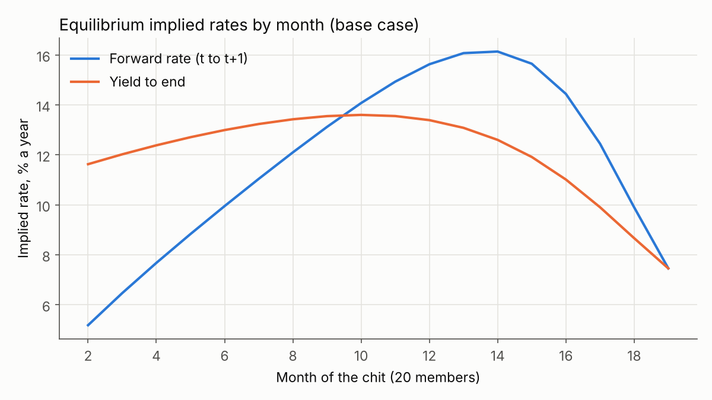
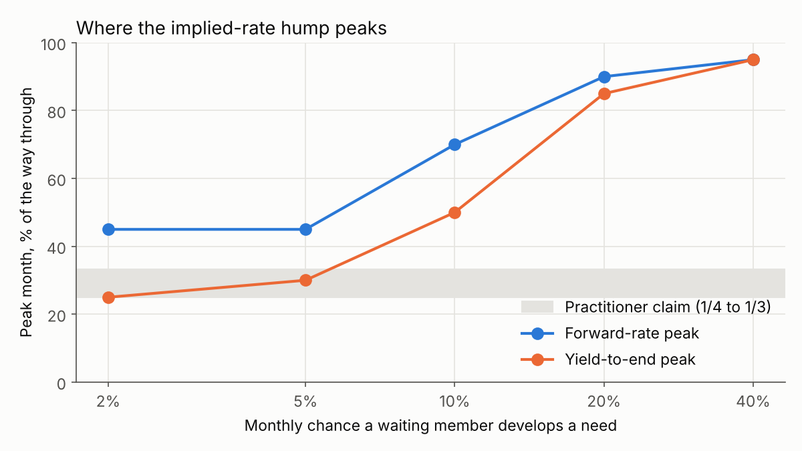
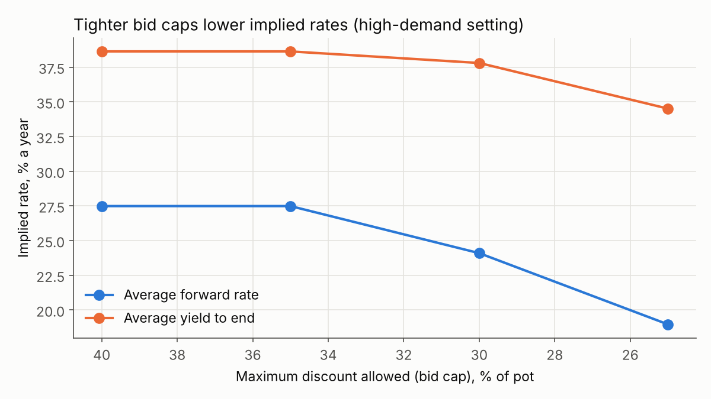
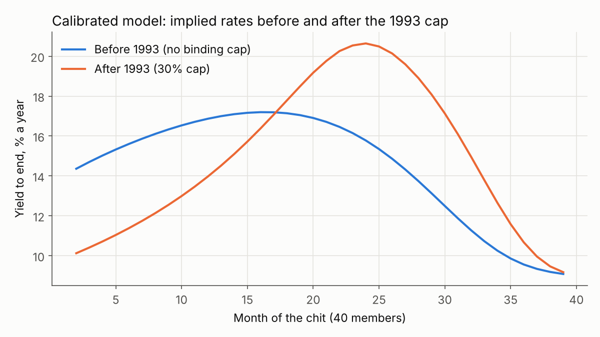

# Chit seats as options

[](https://github.com/sanjayashokbuilds/chit-options/actions/workflows/tests.yml)

**Live app: [chit-options.netlify.app](https://chit-options.netlify.app/)**. Play a chit against bidders who follow the model, explore when chit loans are most expensive, and get bidding advice for a real chit.

A seat in a Tamil chit fund is a one-time right to take the pot in any month, at a price set by auction. That makes it an American option. This project prices it with the standard tools for American options (backward-induction dynamic programming and Longstaff–Schwartz least-squares Monte Carlo), solves for equilibrium bidding when every member does the same, and asks a question practitioners raise but the literature hasn't modelled: **why do implied interest rates in chits peak early-to-mid tenure?**

The model is calibrated to published bid data from a Tamil Nadu chit company. It reproduces the level of chit interest rates and an early-to-mid hump in the implied-rate curve, and it gets the effect of the 1993 bid cap only half right. Both the successes and the failures are reported below.

Built as a 24-hour solo project by Sanjay Ashok. Everything is one tested Python package (45 tests); the web app runs the same package in the browser.

---

## Contents

1. [How a chit works](#how-a-chit-works)
2. [Why a seat is an American option](#why-a-seat-is-an-american-option)
3. [What existed before, and what is new](#what-existed-before-and-what-is-new)
4. [The model](#the-model)
5. [Methods](#methods)
6. [Validation](#validation)
7. [Results](#results)
8. [Calibration to real chits](#calibration-to-real-chits)
9. [The web app and bidding calculator](#the-web-app-and-bidding-calculator)
10. [Limitations and next steps](#limitations-and-next-steps)
11. [Repository and reproduction](#repository-and-reproduction)
12. [References](#references)

---

## How a chit works

*N* members each pay a fixed instalment every month for *N* months, so each month there is a pot of *N* × instalment. In registered chits the foreman (the organiser) takes the first pot. After that, every month the members who haven't yet had a pot bid a **discount**: how much of the pot they are willing to give up. The highest bid wins; the winner receives the pot minus the discount and keeps paying instalments but can't bid again. The foreman takes a commission out of the discount, and the rest is shared equally as a **dividend** that reduces everyone's payment that month.

Worked example: 10 members, ₹100 a month, so a ₹1,000 pot, and a 5% commission. If the month-2 winner bids 30%, they receive ₹700; the foreman keeps ₹50; the other ₹250 is shared, so everyone pays ₹75 that month instead of ₹100.

An early winner gets a lump sum and repays it in later instalments: they are **borrowing**. A late winner pays in first and collects at the end: they are **saving**, with the dividends as their return.

## Why a seat is an American option

An American option is a right you can exercise once, at any time before it expires. A chit seat is the same: you can take the pot in any month, once. Waiting has value, because you might win more cheaply later, and a cost, because a need for cash might arrive while you wait. The discount you pay plays the role of the strike price, but it is set by out-bidding the other members, so every exercise changes everyone else's options. That is why the project values one seat with everyone else's behaviour fixed first, then moves to equilibrium.

One fact makes the option view clean: **every member pays the same amount each month, whether or not they have already won.** So for one member, "win in month *t*" versus "win in month *u*" differs only in the payout, *pot × (1 − d_t)* at *t* versus *pot × (1 − d_u)* at *u*. The fraction of the pot a winner keeps works like a zero-coupon bond price, and reading interest rates off winning bids is reading a yield curve off bond prices (`chit/implied.py`; a test checks the fact directly).

## What existed before, and what is new

**Existing work, which this project builds on and does not claim to replace:**
- Besley, Coate and Loury (1993) set out the economics of rotating savings and credit associations (ROSCAs), including bidding ROSCAs.
- Kovsted and Lyk-Jensen (1999) model ROSCAs with stochastic needs and compare random and bidding allocation.
- Stefan Klonner models chits as sequences of auctions in which members receive new information before each auction, studies how the auction format affects prices, and finds that average implied rates line up with outside rates. With Ashok Rai he uses a chit company's records to study how the 1993 bid cap affected bids and defaults.
- Eeckhout and Munshi, as cited by Klonner and Rai, report implicit chit interest rates of roughly 14–24% falling to 9–17% after the cap.
- A Japanese paper, *Mathematics for Interest Rates of Rotating Savings and Credit Associations*, compares ways of computing ROSCA interest rates (the Okura method versus IRR).

**What this project adds** (we found no earlier work doing these; that is the result of a search, not a guarantee):
- Valuing a seat with American-option methods: backward-induction DP and Longstaff–Schwartz, cross-validated against each other.
- Option-style sensitivities ("Greeks") of the seat's value.
- A model-based account of when in a chit's life implied rates peak, tested against the practitioner claim of 1/4 to 1/3 of the way through.
- An exact term structure of implied rates (forward rates and yields to end) from a Markov chain, rather than from simulation.
- An open bidding calculator that infers how many members need cash from past bids.

## The model

| Setting | Default | Status |
|---|---|---|
| Members and months | *N* each | |
| Foreman's month | Foreman takes month 1's pot at no discount and no commission | Matches the company in Klonner & Rai |
| Commission | 5% of the pot per auction | Klonner & Rai report 5–6%. The legal cap rose from 5% to 7% with the Chit Funds (Amendment) Act 2019 ([PRS](https://prsindia.org/billtrack/the-chit-funds-amendment-bill-2019)) |
| Bid cap | 40% (none before 1993) | A 30% cap was enforced from 1993 and relaxed to 40% in 2002 (Klonner & Rai). The current statutory text was not checked |
| Auction | Oral ascending: the winner pays the second-highest willingness | Verified (Klonner & Rai) |
| Ties at the cap | Equal-odds lottery | Verified (Klonner & Rai) |
| Dividend | (discount − commission) shared equally among all *N* members | Modelling choice |
| Minimum bid | Equal to the commission, so dividends are never negative | Modelling choice |
| Cash needs | Each month a waiting member develops a need with probability *p*; it lasts until they win | Modelling choice; *p* calibrated |
| Outside rates | Borrow at *r_b*, save at *r_s*, monthly | *r_b* calibrated; *r_s* = 9% a year |
| Valuation | Next month's money is worth 1/(1 + *r*) now, with *r* = *r_b* while in need and *r_s* otherwise | Modelling choice |
| Information | Members know how many others are in need | A full-information benchmark; see limitations |

## Methods

**1. Mechanics and implied rates** (`mechanics.py`, `rates.py`, `implied.py`). Every member's cash flow in every month for a full auction path, with money conservation tested. A per-member IRR turns out to be the wrong measure: a mid-tenure member pays, receives, then pays again, so their cash flows can have two IRRs or none (the code finds every root and says so). The project uses per-auction rates instead:
- the *forward rate* f_t, from (1 − d_t)(1 + f_t) = 1 − d_{t+1}: the price of getting the pot one month earlier;
- the *yield to end* y_t, from (1 − d_t)(1 + y_t)^(months left) = 1 − commission: the winner's average rate to the end;
- the per-winner *loan rate* used by Klonner and Rai, kept for comparison. It ignores what a winner paid in before winning, so late winners show negative rates.

**2. Dynamic programming** (`env.py`, `dp.py`). With every rival bidding by a simple "myopic" rule, one member's situation is fully described by (month, own need, number of rivals in need). Starting from the last month, where the member must take the pot, each month compares bidding with waiting using next month's values, exactly as an American option is priced on a tree. Output: the seat's value and the map of states where bidding is optimal (the exercise boundary).

**3. Longstaff–Schwartz** (`lsm.py`). The same problem, solved by simulating 50,000 futures, learning the value of bidding versus waiting by regression on the state, and valuing the learned rule on fresh paths (valuing it on the paths that chose it would flatter it).

**4. Equilibrium** (`equilibrium.py`). Everyone optimises at once. In an oral ascending auction you stay in while winning at the current price beats dropping out. At price *d* your payment that month is the same either way and cancels, so your limit is

> d* = 1 − (value of still waiting − value of having won), both discounted to next month.

Starting from the myopic rule, every member's best-response limit is found by backward induction, the shared table moves halfway towards it, and this repeats until the table stops changing.

**5. Exact term structure** (`analysis.py`). When everyone follows the same table, only *K*, the number of waiting members in need, matters, and *K* is a Markov chain. Pushing its distribution forward month by month gives exact expected discounts, forward rates and yields.

**6. Calibration** (`calibrate.py`). The two unobservable settings (*p* and *r_b*) are chosen by grid search to match two published bid statistics; the model is then checked against statistics it was not fitted to.

**7. Bidding advice** (`calculator.py`). A hidden-Markov forward filter: each past winning discount is evidence about how many members were in need, so applying Bayes' rule month by month gives a belief about how many are in need now. The member's limit is their best-response limit averaged over that belief.

## Validation

| Check | Result |
|---|---|
| DP vs brute force | In a 4-member chit the DP's value equals the best of all 1,024 possible strategies |
| DP vs simulator | Playing the DP's strategy in the separate month-by-month simulator reproduces its value within Monte Carlo error, on several seeds and settings |
| LSM vs DP | With an indicator basis (one regression column per state), LSM's out-of-sample value matches the DP; mean z-score about 0 over 8 seeds |
| LSM basis | A smooth cubic basis, the textbook choice, loses about 0.5% of the pot at *N* = 20: the optimal rule jumps between "no rival in need" and "one rival in need", which a cubic can't represent |
| Equilibrium | Same table from three different starting points; no member can gain by deviating (gain below 10⁻⁸ of the pot); value matches the simulator |
| Exact term structure | Matches simulated averages of discounts and forward rates within Monte Carlo error |
| Calibration | Recovers known settings from moments generated by those settings |
| Calculator | On simulated chits the filter puts more probability on the true number in need than the no-information forecast does |

**Bugs the checks caught.**
1. In NumPy, 1 to the power NaN is 1, so the last month's yield silently came out as 0% instead of undefined. A test caught it.
2. With a binding cap, the "can anyone gain by deviating?" check reported a gain of 1.6% of the pot. Damped iteration approaches the cap without reaching it, so a limit of 29.99999999% wasn't treated as a tie with 30%, turning a lottery into a sure win. Near-ties now count as ties, the gain is zero, and a regression test keeps it that way.
3. In 1 of the 144 settings precomputed for the web app (40 members, needs in 20% of months, borrowing at 5% a month, no cap) the iteration ends in a tiny cycle, the table moving by about 10⁻⁶, again because of near-ties. Nobody can gain by deviating, so the result is accepted and flagged in the data.

## Results

### The implied-rate curve is hump-shaped, and how often needs arrive sets where it peaks

Stylised case: 20 members, needs in 10% of months, borrowing at 2% a month, saving at 0.5%, 5% commission, 40% cap.



Both measures rise then fall. In this case the yield to end peaks in month 10 of 20 (half way) and the forward rate in month 14; both average about 12% a year.



- **The borrowing rate sets the level; the need frequency sets the shape.** Raising the borrowing rate from 1% to 4% a month lifts the average yield from 8% to 20% a year but leaves the peak where it is.
- **Rare needs give an early-to-mid peak.** With needs in 2–5% of months, the yield to end peaks 25–30% of the way through, inside the practitioner range. With common needs it peaks late. The forward rate always peaks later than the yield.
- **Why** (an explanation consistent with the model's output, not yet a formal decomposition): unmet needs pile up among the members still waiting, which keeps discounts high for a while; meanwhile the shrinking time left makes an early pot worth less, which pulls discounts down. The yield spreads the discount over the months left, so it rises while discounts fall slowly and falls once they drop quickly. The rarer needs are, the sooner the second force wins.

### Option sensitivities ("Greeks")

Change in the equilibrium seat value, as a fraction of the pot, per unit change in a setting (central finite differences, stylised case): commission −0.91; borrowing rate −0.70; saving rate +0.58; need probability −0.25. For example, one percentage point more commission costs a seat about 0.9% of the pot.

### Bid caps

In a high-demand stylised setting (needs in 20% of months, borrowing at 4% a month), where early discounts reach 33%, tightening the cap lowers the average forward rate from 27.5% a year (cap 40%) to 24.1% (30%) and 19.0% (25%).



## Calibration to real chits

Data: the chit company in Tamil Nadu studied by Klonner and Rai; its most common group had 40 members, 40 months, ₹250 a month and a ₹10,000 pot. Fixed: 5% commission, 9% a year saving rate, no binding cap before 1993. Our readings of the data are listed in `chit/calibrate.py` (for example, "early" means the auctions in the first half of the chit).

| Before the 1993 cap | Data | Model |
|---|---|---|
| Average early winning bid | 35.1% of the pot | 33.7% |
| Share of early winning bids at or above 30% | 79.1% | 78.8% |

**Fitted:** needs arrive in 4.25% of months; outside borrowing costs 3.3% a month (about 48% a year, in the range of informal credit).

**What the calibrated model gets right**
- Implied rates before the cap average about 14.5% a year, inside the 14–24% reported by Eeckhout and Munshi.
- The yield to end peaks in month 16 of 40 (40% of the way through): early-to-mid tenure, just past the practitioner range of 1/4 to 1/3. The forward rate peaks later.
- The 30% cap lowers early winning discounts (33.7% to 29.9%) and the average forward rate (14.7% to 10.7% a year), the direction seen in the data.



**What it gets wrong** (statistics it was not fitted to)
- After the cap the model puts 95% of early bids at the cap; the data show 72%. Identical members bunch at the cap far more than real, varied members do.
- The model says capping early bids pushes demand later, so late discounts *rise* (14.6% to 16.9%) and the average yield to end rises slightly (14.5% to 15.0%). In the data late bids *fell*, by much less than early bids. Klonner and Rai explain the post-cap pattern with adverse selection among risky borrowers, which this model leaves out.

So the model reproduces the level of rates and the early-to-mid hump, but its account of the cap is only half right.

## The web app and bidding calculator

**[chit-options.netlify.app](https://chit-options.netlify.app/)** is a static site (`docs/`) with four parts.

**Play a chit.** You take a seat in a 10-member chit (₹1,000 a month) against nine rivals who bid the model's equilibrium. Each month the bidding climbs live and you choose when to drop out; cash emergencies arrive at random, and while you need cash without the pot it costs you the outside borrowing rate. An optional coach shows the model's limit for your situation. At the end, the same chit, with the same emergencies and the same lottery draws, is replayed with the model's rule in your seat, so the comparison is fair: you see whether you beat the model and by how much, in today's money, along with your month-by-month cash.

**When are chit loans most expensive?** Pick the number of members, how often needs arrive, the cost of outside loans and the bid cap, and see the exact implied-rate curves for that setting (144 precomputed equilibria), with the practitioner range marked.

**Checked against real chits.** The calibration, the before-and-after-cap curves, and what the model gets right and wrong.

**Should I bid this month?** The calculator for a real chit: enter its size, instalment, cap and the winning bids so far, and whether you need cash. It infers how many members probably need cash from past bids and returns your limit, your chance of winning and the likely price. It runs this repository's Python in the browser with [Pyodide](https://pyodide.org). The same calculator works from the command line:

```bash
python scripts/advise.py --members 40 --instalment 250 --history 0.38,0.37,0.37 --in-need
# Bid up to 37.8% of the pot (3,784 off a pot of 10,000). Chance of winning this month:
# about 42%, at an expected discount of 36.4%.
```

**How the site is built.** Solving equilibria in a browser is too slow, so `scripts/build_site.py` precomputes the bidding tables and rate curves as JSON and copies the package into `docs/py/` for Pyodide. The game's chit engine is written in JavaScript for speed; a test (`tests/test_web.py`, using `tests/game_engine_check.js`) runs it 6,000 times and checks its average winning bid in every month against the Python model's exact numbers. Chart colours are checked for colour-blind separation and contrast, and the layout works on phones and in dark mode.

**Deploying.** On Netlify, import the repository; `netlify.toml` publishes `docs/` with no build step. On GitHub Pages: Settings → Pages → Deploy from a branch → `main`, folder `/docs`.

## Limitations and next steps

- **Identical members with full information.** Members differ only in their needs, and know how many others are in need. Klonner's work stresses private information and differences between members; adding both is the most important next step, and is what Longstaff–Schwartz is built for, since it works with whatever a member can actually observe.
- **No default.** The foreman bears default risk in practice and it shapes bids (Klonner and Rai).
- **Thin calibration.** Two published statistics from one company, not bid-by-bid records. With real passbooks the model could be estimated properly.
- **Simplified bidding.** Members drop out at their indifference price; nobody bids just to raise the price others pay.
- **The hump's explanation** is consistent with the output but not yet formally decomposed.

## Repository and reproduction

```
chit/              the package (numpy only)
  mechanics.py     cash flows of one chit
  rates.py         NPV and IRR, all roots
  implied.py       forward rates, yields, loan rates
  members.py       needs, outside rates, myopic bidding
  simulate.py      month-by-month simulator
  env.py, dp.py    one member against myopic rivals: dynamic programme
  lsm.py           Longstaff-Schwartz
  equilibrium.py   symmetric equilibrium
  analysis.py      exact term structure, sensitivities, Greeks
  calibrate.py     calibration to Klonner & Rai
  calculator.py    bidding advice (hidden-Markov filter)
  web.py           JSON entry point for the browser
scripts/           results, calibration, site build, command-line advice
results/           figures and JSON outputs
docs/              the web app: index.html, style.css, app.js, charts.js,
                   game.js (the chit game), data/ (precomputed JSON), py/ (package copy)
tests/             45 tests, plus game_engine_check.js for the browser game
netlify.toml       publishes docs/ on Netlify
```

```bash
pip install -e ".[dev,results]"
pytest                              # 45 tests, about 20 s
python scripts/run_results.py       # stylised results and figures, about 20 s
python scripts/run_calibration.py   # calibration and the 1993-cap check, a few minutes
python scripts/build_site.py        # data for the web app, about 15 minutes
```

## References

- Besley, T., Coate, S. and Loury, G. (1993). The economics of rotating savings and credit associations. *American Economic Review*.
- Eeckhout, J. and Munshi, K. Matching in informal financial institutions; figures as cited in Klonner and Rai.
- Klonner, S. (2002). Understanding chit funds: price determination and the role of auction formats in ROSCAs.
- Klonner, S. (2003). Buying fields and marrying daughters: an empirical analysis of ROSCA auctions in a South Indian village.
- Klonner, S. (2008). Private information and altruism in bidding ROSCAs. *Economic Journal*.
- Klonner, S. and Rai, A. S. Adverse selection in credit markets: evidence from a policy experiment. [Working paper](https://web.williams.edu/Economics/rai/adverse-08-9-1.pdf).
- Kovsted, J. and Lyk-Jensen, P. (1999). Rotating savings and credit associations: the choice between random and bidding allocation of funds. *Journal of Development Economics*.
- Longstaff, F. and Schwartz, E. (2001). Valuing American options by simulation: a simple least-squares approach. *Review of Financial Studies*.
- *Mathematics for Interest Rates of Rotating Savings and Credit Associations* (compares the Okura method with IRR).
- PRS Legislative Research. [The Chit Funds (Amendment) Bill, 2019](https://prsindia.org/billtrack/the-chit-funds-amendment-bill-2019).
