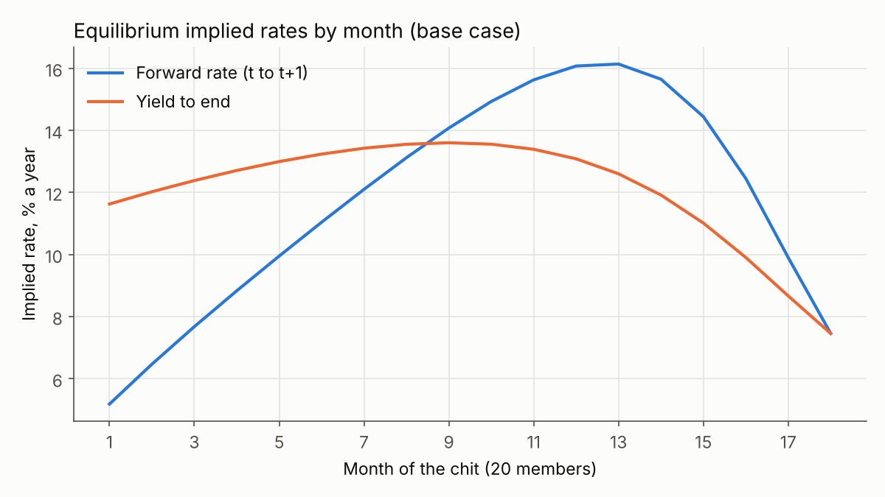
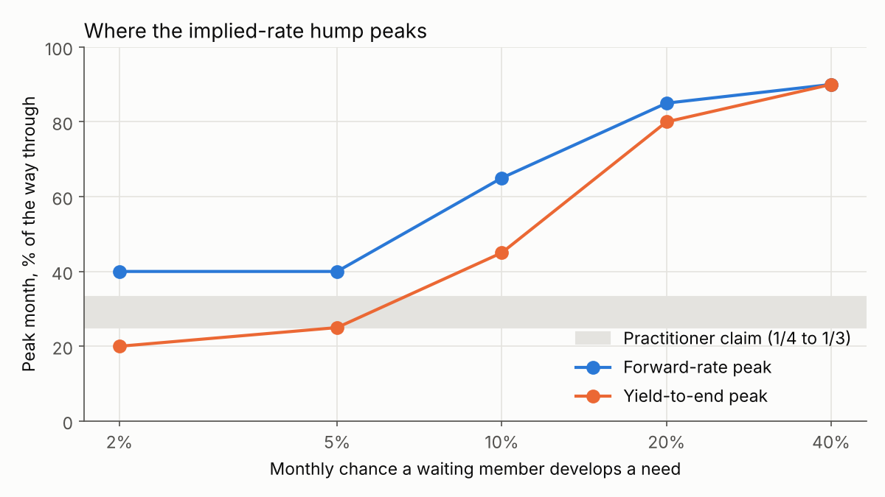

# chit-options

Valuing a seat in a Tamil chit fund with American-option methods (dynamic programming, Longstaff-Schwartz), and solving for equilibrium bidding.

Work in progress: a 24-hour build. Full write-up to follow.

```bash
pip install -e ".[dev,results]"
pytest                          # 41 tests
python scripts/run_results.py   # solves every scenario, writes results/ (about 20 s)
```

## Modules so far

- `chit/mechanics.py`: one chit's payouts, payments, commission and every member's cash flows.
- `chit/rates.py`: NPV and IRR, finding every root (chit cash flows can have two IRRs or none).
- `chit/implied.py`: the term structure implied by winning bids (forward rates, yields to end, per-winner loan rates).
- `chit/members.py`: why members bid. Outside borrowing/saving rates, random cash needs, and simple bidding strategies.
- `chit/simulate.py`: plays out whole chit groups month by month, with English (open ascending) or sealed auctions.
- `chit/env.py`: the chit as one member sees it when all rivals bid myopically; the exact small state (month, own need, needy rivals).
- `chit/dp.py`: backward-induction dynamic programme: the seat's value and the optimal bid / pass map (exercise boundary).
- `chit/lsm.py`: Longstaff-Schwartz least-squares Monte Carlo for the same problem, valued out of sample.
- `chit/equilibrium.py`: symmetric equilibrium. Everyone bids up to their indifference price; best responses are iterated (with damping) until the willingness table stops changing.
- `chit/analysis.py`: the exact equilibrium term structure (the number of needy members is a Markov chain, so its distribution is pushed forward month by month), sensitivities and finite-difference "Greeks".
- `chit/calibrate.py`: fits the need probability and outside borrowing rate to published chit-company bid statistics.
- `chit/calculator.py`: bidding advice. A Bayesian (hidden-Markov) filter infers how many members are in need from past winning bids; the equilibrium then gives your limit, chance of winning and expected price.
- `scripts/run_results.py`: every scenario, `results/results.json` and the figures.
- `scripts/run_calibration.py`: the calibration and the 1993-cap check, `results/calibration.json`.
- `scripts/advise.py`: the calculator from the command line.

## Validation of the numerical methods

- **DP vs brute force:** in a 4-member chit, the DP's value equals the best of all 1,024 possible policies.
- **DP vs simulator:** playing the DP's policy in the independent month-by-month simulator reproduces the DP's value within Monte Carlo error.
- **LSM vs DP:** with an indicator basis (one regression column per state), LSM's out-of-sample value matches the DP within Monte Carlo error across seeds (mean z-score about 0 over 8 seeds, N = 20).
- **Equilibrium:** converges to the same table (to 1e-10) from three different starting points (myopic, everyone at the minimum, everyone at the cap). A member's gain from deviating is zero to machine precision. Its value matches the simulator.
- **Exact term structure vs simulation:** month-by-month average discounts and forward rates agree within Monte Carlo error.
- **Basis choice matters:** a smooth cubic basis, the textbook LSM choice, loses value (e.g. about 0.5% of the pot at N = 20). The optimal rule has a step between "no needy rival" and "one needy rival", which a cubic can't represent.

## Rules and conventions used

| Setting | Default | Source / status |
|---|---|---|
| Foreman's commission | 5% of pot per auction | Legal cap raised from 5% to 7% by the Chit Funds (Amendment) Act 2019 ([PRS India](https://prsindia.org/billtrack/the-chit-funds-amendment-bill-2019)). Klonner & Rai report 5-6% in practice. |
| Maximum discount | 40% of pot | 30% cap enforced from 1993, relaxed to 40% in 2002, per [Klonner & Rai](https://web.williams.edu/Economics/rai/adverse-08-9-1.pdf). Current statutory text still to confirm. |
| Foreman's month | Foreman takes month 0's pot at zero discount, no commission | Matches the company data in Klonner & Rai. |
| Dividend | (discount - commission) split equally among all N members | Modelling choice. |
| Minimum bid | equal to the commission | Keeps dividends non-negative. Modelling choice. |
| Cash needs | Each month a waiting member gets a need with probability `p_need`; it lasts until they win | Modelling choice. |
| Outside rates | Borrow at 2%/month, save at 0.5%/month | Placeholder values, to calibrate. |
| Auction format | English (winner pays second-highest willingness); sealed also available | Verified: Klonner & Rai describe the company's auctions as oral ascending. |
| Ties | Broken by lottery (e.g. several members at the cap) | Verified: Klonner & Rai report an equal-odds lottery among bidders tied at the ceiling. |
| Information (DP/LSM) | The valued member knows how many rivals are in need | Full-information benchmark: an upper bound on the seat's value. |
| Actions (DP/LSM) | Bid up to the cap, or sit the month out (never win by lottery when passing; no bidding just to raise others' price) | Modelling choice. |
| Discounting (DP/LSM) | Next month's money is worth 1/(1+r), with r = borrowing rate while in need, saving rate otherwise | Modelling choice. |

## Results: stylised settings

Base case: 20 members, 2%/month borrowing, 0.5%/month saving, 10% monthly chance of a need, 5% commission, 40% cap.



- **Implied rates are hump-shaped.** The yield to end peaks around month 9 (45% of the way through) and the forward rate around month 13 (65%). The average is about 12% a year.
- **The peak's position depends on how common needs are, not on the borrowing rate.** The borrowing rate moves the whole curve up or down (average yield 8% a year at 1%/month borrowing, 20% at 4%) but leaves the peak where it is. Rare needs (2-5% a month) put the yield peak at 20-25% of the tenure, close to the practitioner claim of 1/4 to 1/3. Common needs push it late. The forward-rate peak is never earlier than 40% in the range tested.



- **So the model can produce an early-to-mid peak, but only under some settings and for one rate measure.** That is a conditional result, not a confirmation. Calibrating the need probability to real data is the next step.
- **Proposed explanation (to be decomposed formally):** two forces pull against each other. Unmet needs pile up among members still waiting (the needy share rises from 19% in month 1 to about 41% by month 10 in the base case), which keeps discounts high. Meanwhile the shrinking time left makes an early pot worth less, which pulls discounts down. The yield is the discount spread over the months left, so it rises while discounts fall slowly and falls once they collapse.
- **Bid caps:** in the base case the cap never binds. In a high-demand setting (20% need chance, 4%/month borrowing), where early discounts reach about 33%, tightening the cap lowers the average forward rate: 27.5% a year (cap 40%), 24.1% (cap 30%), 19.0% (cap 25%). That matches the direction of the fall in rates after the 1993 cap reported by Eeckhout & Munshi, as cited by Klonner & Rai.


- **"Greeks" (change in equilibrium seat value, as a fraction of the pot, per unit change in a setting):** commission -0.91, borrowing rate -0.70, saving rate +0.58, need probability -0.25. For example, a 1 percentage point higher commission costs a seat about 0.9% of the pot.

## Calibration to real chit-company data

There are no member-level cash-need data, so the two unobservable settings (how often needs arrive, what outside credit costs) are chosen to reproduce published bid statistics from [Klonner & Rai](https://web.williams.edu/Economics/rai/adverse-08-9-1.pdf). Their data come from a chit company in Tamil Nadu; the most common group had 40 members, 40 months, Rs 250 a month and a Rs 10,000 pot.

| | Data (before the 1993 cap) | Model |
|---|---|---|
| Average early winning bid | 35.1% of pot | 33.7% |
| Share of first-half bids at or above 30% | 79.1% | 78.8% |

Fitted settings: a 4.25% monthly chance of a cash need and an outside borrowing rate of 3.3% a month (about 48% a year, in the range of informal moneylender credit). Fixed: 5% commission, 9% a year saving rate, no binding cap before 1993. `chit/calibrate.py` lists every reading of the data we had to make. A test checks that the calibration recovers known settings from their own moments.

**What the calibrated model gets right**
- Implied rates before the cap average about 14.5% a year, inside the 14-24% range reported by Eeckhout & Munshi (as cited by Klonner & Rai).
- The implied-rate hump is real and peaks early-to-mid: the yield to end peaks in month 15 of 40 (37.5% of the way through), just past the practitioner range of 1/4 to 1/3. The forward rate peaks later (57.5%).
- The 30% cap lowers early winning discounts (33.7% to 29.9%) and the average forward rate (14.7% to 10.7% a year), the direction seen in the data.


**What it gets wrong (out-of-sample checks, not targeted)**
- After the cap, the model puts 95% of first-half bids at the cap; the data show 72%. Identical members bunch at the cap far more than real, varied members do.
- The model predicts that capping early bids pushes demand later, so late discounts *rise* (14.6% to 16.9%) and the yield-to-end measure rises slightly overall. In the data, late bids *fell*, just much less than early bids. Klonner & Rai explain the post-cap pattern with adverse selection (risky borrowers), which this model leaves out.

So the model reproduces the levels and the early-to-mid hump, but its account of the cap is only half right. Member heterogeneity and default risk are the obvious next steps.

## Bidding calculator

```bash
python scripts/advise.py --members 40 --instalment 250 --history 0.38,0.37,0.37 --in-need
```

Given the chit's settings, the winning discounts so far and whether you're in need, it:
1. infers how many members are probably in need from past bids, with a hidden-Markov forward filter on the needy-count chain (tested: on simulated chits the filter puts more probability on the true count than the no-information forecast does);
2. gives your limit (the most of the pot worth giving up this month), your chance of winning at that limit and the expected price, using the calibrated equilibrium and, optionally, your own borrowing rate.

Approximation: the equilibrium assumes members know how many others are in need; the calculator replaces that knowledge with the filter's belief.

## Limitations so far

- Members are identical and know how many others are in need (full information). Klonner's work stresses private information, which we don't model yet.
- No default risk; the foreman bears it in practice and it affects bids (Klonner & Rai).
- Calibrated to two published moments from one chit company, not to bid-by-bid data.
- Members are identical, which makes them bunch at the cap far more than in the data.
- Members drop out at their indifference price; nobody bids just to push up the price others pay.
